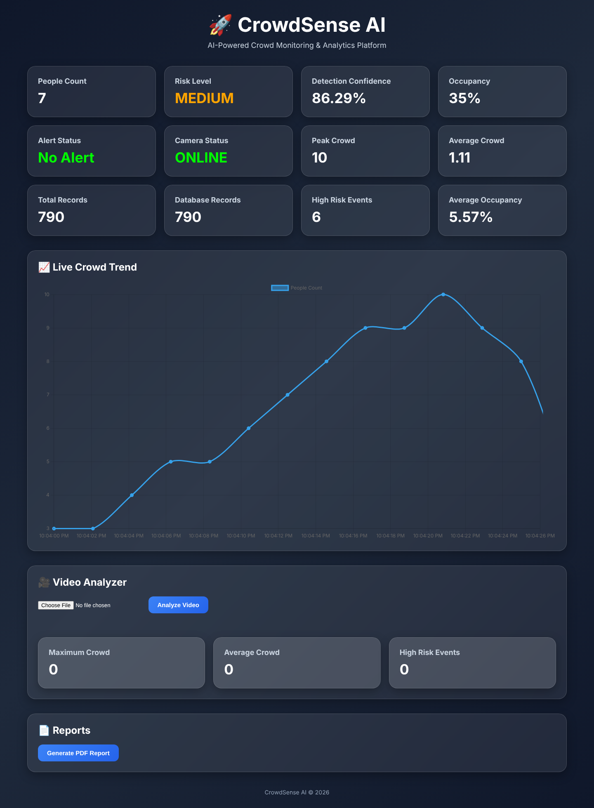
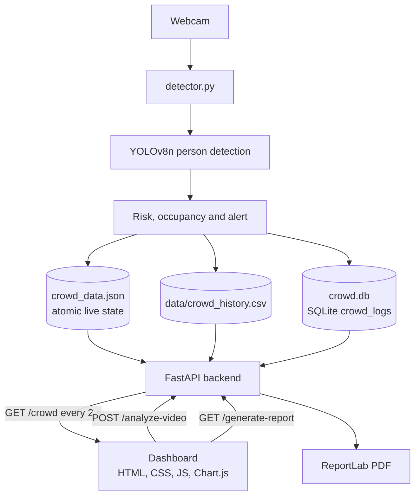
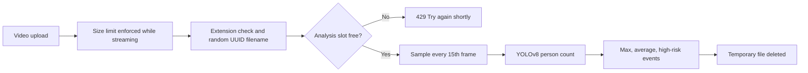

<div align="center">

# 👥 CrowdSense AI

### AI-powered crowd monitoring, risk classification and analytics platform

Count people in real time with YOLOv8, classify crowd risk, track occupancy and alerts on a live dashboard, analyse uploaded videos, and export PDF reports, all from a FastAPI backend and a lightweight JavaScript frontend.

[](requirements.txt)
[](backend/main.py)
[](detector.py)
[](backend/video_analyzer.py)
[](backend/database.py)
[](frontend/index.html)
[](#-testing)

<br />



<br />

**[Live Demo](https://crowd-sense-ai-kappa.vercel.app)** · **[Quick Start](#-quick-start)** · **[Features](#-core-features)** · **[Architecture](#%EF%B8%8F-system-architecture)** · **[API](#-api-overview)** · **[Testing](#-testing)** · **[Troubleshooting](#%EF%B8%8F-troubleshooting)**

</div>

---

## 📌 Project Overview

**CrowdSense AI** watches a camera feed, counts every person YOLOv8 detects, and turns that count into a risk level, an occupancy percentage and an alert. A FastAPI service exposes the live state together with historical analytics, and the dashboard polls it every two seconds.

```text
Webcam → YOLOv8 person detection → Count, confidence, risk, occupancy
                                              ↓
          crowd_data.json (live heartbeat) · crowd_history.csv · SQLite crowd_logs
                                              ↓
          FastAPI  /crowd · /analyze-video · /generate-report  →  Dashboard (Chart.js)
```

Uploaded videos go through the same model, sampling one frame in fifteen, and return the peak crowd, the average crowd and the number of high-risk episodes.

> [!NOTE]
> The live camera detector runs on your own machine (`detector.py`). The hosted demo serves the dashboard, analytics and PDF reports. Video inference on the free cloud tier may run out of memory because of the model's resource needs, so run video analysis locally for reliable results.

---

## ✨ Core Features

| Module | What it provides |
|---|---|
| 🎯 **Person Detection** | YOLOv8n (`yolov8n.pt`) detects people frame by frame from a webcam, with boxes and confidence drawn on screen. |
| 🔢 **Crowd Counting** | Live people count and average detection confidence for every frame. |
| 🚦 **Risk Classification** | LOW, MEDIUM and HIGH levels from the people count, colour-coded on the dashboard. |
| 🏟️ **Occupancy Monitoring** | Count as a percentage of the configured venue capacity. |
| 🚨 **Alert System** | `HIGH CROWD DETECTED` raised on the dashboard and on the camera overlay when risk is HIGH. |
| 📡 **Camera Heartbeat** | The camera shows OFFLINE automatically if the detector stops or its data is more than 10 seconds old. |
| 📈 **Live Trend Chart** | The last 15 readings plotted with Chart.js, refreshed every 2 seconds. |
| 🗂️ **Historical Analytics** | Peak crowd, average crowd and record count from the CSV history log. |
| 🗄️ **SQLite Database** | Every reading logged to `crowd_logs`, with high-risk event count and average occupancy. |
| 🎥 **Video Analyzer** | Upload MP4, AVI, MOV, MKV or WebM to get the max crowd, average crowd and high-risk events. |
| 📄 **PDF Reports** | One-click report with camera status, current count, peak, average, occupancy and database totals. |

### How risk is classified

| Rule | Value |
|---|---|
| LOW | fewer than 3 people |
| MEDIUM | 3 to 7 people |
| HIGH | 8 or more people (raises the alert) |
| Occupancy | people ÷ capacity of 20, capped at 100% |
| History logging | one CSV row and one database row every 5 seconds |
| Live state | written twice a second; considered stale after 10 seconds |
| Video sampling | every 15th frame at 256 px, confidence ≥ 0.4 |
| High-risk event (video) | counted once each time the crowd enters HIGH |

---

## 🏗️ System Architecture



### Video analysis



### Design principles

- **The dashboard never shows stale data as live.** The detector writes a timestamped heartbeat; anything older than 10 seconds is reported as OFFLINE.
- **State writes are atomic.** Live state is written to a temporary file and swapped in, with retries when Windows or OneDrive briefly locks the file.
- **The detector keeps running.** Dropped webcam frames and failed log writes are tolerated instead of stopping the camera.
- **Uploads are untrusted.** Filenames are replaced with UUIDs, extensions are allow-listed, size is checked before parsing, and files are deleted after analysis.
- **One video at a time.** A single analysis slot protects memory on small servers.
- **Zero setup for storage.** The database, tables and folders are created automatically on first run.

---

## 🛠️ Technology Stack

| Layer | Technology |
|---|---|
| Detection | Ultralytics YOLOv8n, OpenCV |
| Backend | Python 3.11, FastAPI, Uvicorn, python-multipart |
| Storage | SQLite (`crowd.db`), CSV history, JSON live state |
| Reports | ReportLab |
| Frontend | HTML, CSS, vanilla JavaScript, Chart.js 4.4 |
| Testing | `unittest`, FastAPI `TestClient`, httpx |
| Hosting | Vercel (dashboard) · Render (API) |

Dependencies: [requirements.txt](requirements.txt) and [requirements-dev.txt](requirements-dev.txt).

---

## 🚀 Quick Start

### Prerequisites

- **Python 3.11** and **Git**
- A **webcam** for live detection (optional for the dashboard, video analyzer and reports)

### 1. Clone and install

```powershell
git clone https://github.com/devendrarajsingh07/CrowdSense-AI.git
Set-Location CrowdSense-AI
py -3.11 -m venv .venv
.\.venv\Scripts\Activate.ps1
python -m pip install -r requirements.txt
```

On Linux/macOS use `python3.11 -m venv .venv` and `source .venv/bin/activate`.

### 2. Start the API and dashboard

```powershell
python -m uvicorn backend.main:app --reload
```

### 3. Start the camera detector

In a second terminal (with the virtual environment active):

```powershell
python detector.py
```

Press **Escape** in the detector window to stop it cleanly.

### 4. Open the app

| Service | Default URL |
|---|---|
| Dashboard | [http://127.0.0.1:8000/dashboard/](http://127.0.0.1:8000/dashboard/) |
| Live data | [http://127.0.0.1:8000/crowd](http://127.0.0.1:8000/crowd) |
| Swagger API docs | [http://127.0.0.1:8000/docs](http://127.0.0.1:8000/docs) |

The database and its schema are created automatically.

---

## 🌐 Hosted Demo

| Part | Where |
|---|---|
| Dashboard | [crowd-sense-ai-kappa.vercel.app](https://crowd-sense-ai-kappa.vercel.app) |
| API | [crowdsense-ai-zy08.onrender.com](https://crowdsense-ai-zy08.onrender.com) |

- The dashboard chooses its API automatically: same origin under `/dashboard/`, the local API on `localhost` or `file://`, and the Render API everywhere else.
- No camera is attached to the hosted API, so the camera shows **OFFLINE** there; analytics and PDF reports still work.
- The free Render instance sleeps when idle, so the first request can take about a minute.

---

## 🔌 API Overview

| Method | Endpoint | Purpose |
|---|---|---|
| `GET` | `/` | Health message and dashboard link |
| `GET` | `/crowd` | Live state plus CSV and database analytics |
| `POST` | `/analyze-video` | Multipart `file` upload; returns crowd statistics for the video |
| `GET` | `/generate-report` | Downloads `Crowd_Report.pdf` |
| `GET` | `/dashboard/` | Bundled dashboard (static files) |

<details>
<summary><b>Example <code>/crowd</code> response</b></summary>

```json
{
  "people": 7,
  "risk": "MEDIUM",
  "confidence": 86.29,
  "occupancy": 35.0,
  "alert": "No Alert",
  "camera": "ONLINE",
  "updated_at": "2026-10-23T16:34:25.915991+00:00",
  "peak": 10,
  "average": 1.11,
  "records": 790,
  "db_records": 790,
  "high_risk": 6,
  "avg_occupancy": 5.57
}
```

</details>

<details>
<summary><b>Example <code>/analyze-video</code> response</b></summary>

```json
{
  "success": true,
  "max_people": 9,
  "average_people": 4.6,
  "high_risk_events": 1,
  "sampled_frames": 42,
  "failed_frames": 0
}
```

</details>

| Status | Meaning |
|---|---|
| `413` | Video is larger than the upload limit |
| `415` | File type is not a supported video |
| `422` | The video could not be read or analysed |
| `429` | Another video is being analysed; try again shortly |

---

## 🔐 Security and Reliability

- Uploaded files get random UUID names, so a crafted filename cannot write outside `uploads/`.
- Only `.mp4`, `.avi`, `.mov`, `.mkv` and `.webm` are accepted.
- The upload limit is enforced before multipart parsing, including for chunked uploads, and errors keep their CORS headers so the browser can show them.
- Uploaded videos and generated PDFs are temporary and deleted after use.
- Report values are HTML-escaped before rendering into the PDF.
- CORS origins are configurable; credentials are only allowed when origins are listed explicitly.
- Database access uses parameterised SQL queries.

---

## 🧪 Testing

| Suite | Scope |
|---|---|
| **API: 9 tests** | Dashboard serving, offline state, UUID upload paths and clean-up, unsupported types, analyzer failures, declared and chunked oversized uploads, CORS on rejected uploads, PDF reports |
| **Core: 8 tests** | Fresh database creation, atomic state round trip, stale and invalid state, locked-file retry, CSV analytics, path traversal and extension checks |

```powershell
python -m pip install -r requirements-dev.txt
python -m unittest discover -s tests -v
```

---

## 📁 Project Structure

```text
CrowdSense-AI/
├── backend/
│   ├── main.py               # FastAPI app, routes, CORS and upload limit
│   ├── state.py              # Atomic live state and camera heartbeat
│   ├── analytics.py          # Peak, average and record count from CSV
│   ├── db_analytics.py       # High-risk events and average occupancy
│   ├── database.py           # SQLite schema and inserts
│   ├── history.py            # CSV history logging
│   ├── video_analyzer.py     # YOLOv8 analysis for uploaded videos
│   ├── report_generator.py   # PDF reports with ReportLab
│   ├── upload_utils.py       # Upload validation and safe filenames
│   └── paths.py              # Project file locations
├── frontend/
│   ├── index.html            # Dashboard layout
│   ├── script.js             # Polling, chart, uploads and reports
│   └── style.css             # Glass-card dark theme
├── data/
│   └── crowd_history.csv     # Historical readings
├── docs/screenshots/         # README images
├── tests/
│   ├── test_api.py
│   └── test_core.py
├── detector.py               # Live webcam detector
├── check_db.py               # Print the first database rows
├── init_db.py                # Create the database manually
├── crowd_data.json           # Latest live state
├── yolov8n.pt                # YOLOv8 nano weights
├── requirements.txt
├── requirements-dev.txt
└── README.md
```

---

## ⚙️ Environment Configuration

| Variable | Default | Purpose |
|---|---|---|
| `CROWDSENSE_MAX_UPLOAD_MB` | `100` | Maximum video upload size in MB |
| `CROWDSENSE_ALLOWED_ORIGINS` | `*` | Comma-separated list of allowed frontend origins |

| Setting | Where | Default |
|---|---|---|
| API origin for the dashboard | `crowdsense-api-base` meta tag in [frontend/index.html](frontend/index.html) | Auto-detected |
| Venue capacity | `MAX_CAPACITY` in [detector.py](detector.py) | `20` |
| HIGH risk threshold | `HIGH_RISK_THRESHOLD` in [detector.py](detector.py) and [video_analyzer.py](backend/video_analyzer.py) | `8` |
| History log interval | `LOG_INTERVAL_SECONDS` in [detector.py](detector.py) | `5` s |
| Camera | `run_detector(camera_index=0)` in [detector.py](detector.py) | `0` |

---

## 🛠️ Troubleshooting

### The camera shows OFFLINE

1. Make sure `python detector.py` is running in a second terminal.
2. The dashboard marks the camera offline when it has had no update for 10 seconds; check the detector window for errors.
3. On the hosted demo this is expected, because no camera is connected to the cloud API.

### `RuntimeError: Unable to open camera 0`

Close other apps using the webcam (Zoom, Teams, the Camera app), check camera permissions in Windows privacy settings, or try another index such as `run_detector(camera_index=1)`.

### The dashboard says `Request failed` or shows `--`

- Start the API with `python -m uvicorn backend.main:app --reload` and open `/dashboard/` from it.
- If the dashboard is hosted elsewhere, set the `crowdsense-api-base` meta tag and add that origin to `CROWDSENSE_ALLOWED_ORIGINS`.
- The free Render API may be waking up; wait a minute and refresh.

### Video upload fails

- `413`: raise `CROWDSENSE_MAX_UPLOAD_MB` or upload a shorter clip.
- `429`: another video is still being analysed.
- On the free cloud tier, video inference can run out of memory; run it locally instead.

---

## 🗺️ Roadmap

| Area | Status |
|---|---|
| Live detection, risk, occupancy and alerts | ✅ Complete |
| Historical analytics, SQLite logging and PDF reports | ✅ Complete |
| Video analyzer | ✅ Complete |
| Cloud deployment (Vercel + Render) | ✅ Live |
| Multi-camera support | ⏳ Planned |
| Crowd density heatmaps | ⏳ Planned |
| Email alerts | ⏳ Planned |

---

## 🤝 Contributing

1. Create a focused branch for one change.
2. Keep detector thresholds in sync between `detector.py` and `backend/video_analyzer.py`.
3. Add or update tests for behaviour changes.
4. Run `python -m unittest discover -s tests -v` before opening a pull request.

Never commit `.env` files, `.venv/`, `crowd.db`, uploaded videos or generated reports.

---

<div align="center">

### Built to make crowded spaces safer, one frame at a time.

Created by [Devendra Raj Singh](https://github.com/devendrarajsingh07)

</div>
